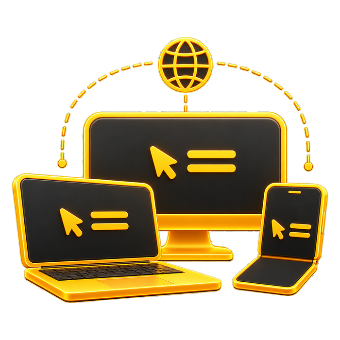

#  Remote

A browser-based remote access gateway for RDP, VNC, SSH, Telnet and local shells. One Rust binary with the web interface built in. No Java, Tomcat or `guacd`.

By Bolt J Woofson @ Woofsons Lab.

---

## Features

**Protocols**
- **RDP**: built on IronRDP, with NLA/CredSSP and TLS, `DOMAIN\user` logins, clipboard sync, dynamic resolution on resize, and performance presets (High Speed, Balanced, High Quality, Custom).
- **VNC (RFB 3.8)**: Raw, CopyRect, Hextile, Zlib and ZRLE encodings, VNC password authentication, VeNCrypt TLS/X.509, and clipboard.
- **SSH**: terminal with password, key or OpenSSH certificate login, plus SFTP file browsing.
- **Telnet**.
- **Local shell** on the server host (bash/sh, or PowerShell on Windows).

**Workspace**
- 1 to 4 panes side by side (Single, Dual, Triple, Quad), switched with `Alt+1` to `Alt+4`.
- Full window mode (`F10` or `Alt+W`) and a session lock screen.
- Terminal based on xterm.js with a bundled JetBrainsMono Nerd Font.
- Per-pane keyboard layout switcher (NO, US, GB, SE, DK, FI, DE, FR, ES, IT, Auto).
- Clipboard drawer for pushing text to and pulling text from remote sessions.
- Drag-and-drop file upload to a staging area.

**Users and access**
- Local accounts in an embedded SQLite database, with Argon2id password hashing and JWT sessions.
- Roles: Admin, Operator, Viewer. Per-connection permissions for connecting, editing, clipboard direction, file transfer and view-only mode.
- Global (shared) and personal connections. Stored connection passwords are encrypted with AES-256-GCM.
- OpenID Connect login (Authentik, Keycloak and others) with automatic user creation and group-to-role mapping.
- Groups, profile pictures, and an audit log.

---

## Quick start

```bash
cargo run --release
```

Open `http://localhost:8088` and log in with `admin` / `remote`. This account is created on first start; change the password right away.

---

## Configuration

Settings live in `config.toml` in the working directory.

| Section | Key settings |
| :--- | :--- |
| `[server]` | `bind_address` (default `0.0.0.0:8088`), `data_dir`, `jwt_secret`, `token_expiry_hours` |
| `[storage]` | `staging_dir`, `max_upload_size_mb`, `auto_cleanup_hours` |
| `[auth]` | `allow_local_login`, `default_role` |
| `[oidc]` | `enabled`, `issuer_url`, `client_id`, `client_secret`, `redirect_uri`, `scopes`, `auto_provision_users`, `admin_group`, `operator_group` |
| `[clipboard]` | `default_mode` (`bidirectional`, `server_to_client`, `client_to_server`, `disabled`), `max_text_size_bytes` |
| `[logging]` | `level` |

Before exposing Remote to a network, set your own `jwt_secret` and review `default_role`.

---

## Project layout

```
src/
  main.rs            Startup and first-run admin account
  config/            Configuration loader
  db/                SQLite storage: users, groups, connections, audit log
  auth/              Password hashing, sessions, encryption, OIDC
  server/            HTTP API and WebSocket session tunnels
  transfer/          File upload staging
  protocols/         rdp.rs, vnc.rs, ssh.rs, telnet.rs, local_pty.rs
frontend/            Web interface (index.html, app.js, app.css), built into the binary
```

---

## Status and roadmap

Planned work and known bugs are tracked in [GitHub Issues](https://github.com/Woofson/remote/issues). Known gaps:
- Windows drive redirection (`\\tsclient\Dropbox`) is currently missing ([#5](https://github.com/Woofson/remote/issues/5)).
- Running behind a reverse proxy is not fully supported yet ([#3](https://github.com/Woofson/remote/issues/3)).

Release history: [CHANGELOG.md](CHANGELOG.md).

---

## License

MIT. Copyright (c) 2026 Bolt J Woofson.
