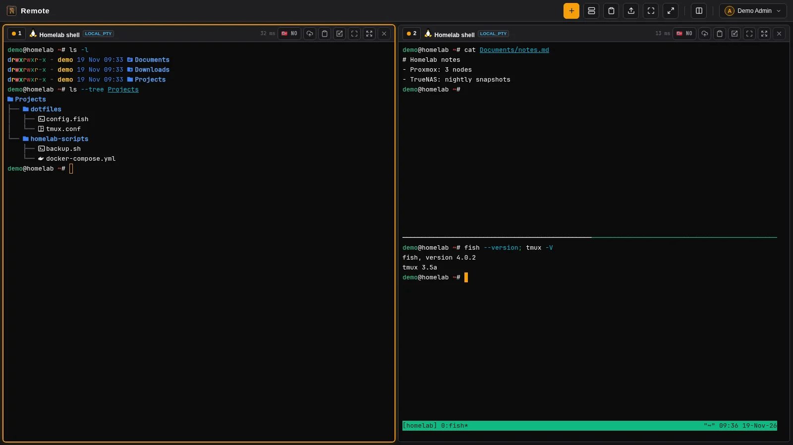
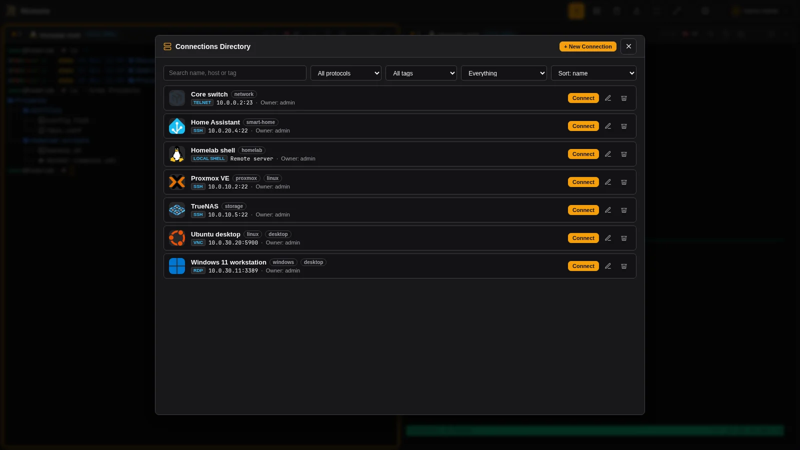
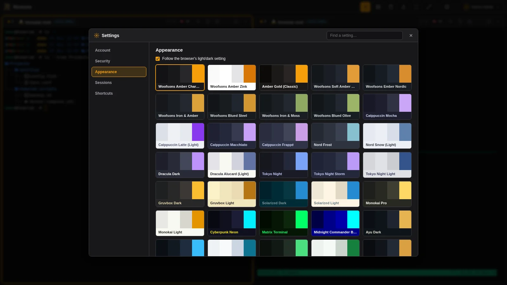
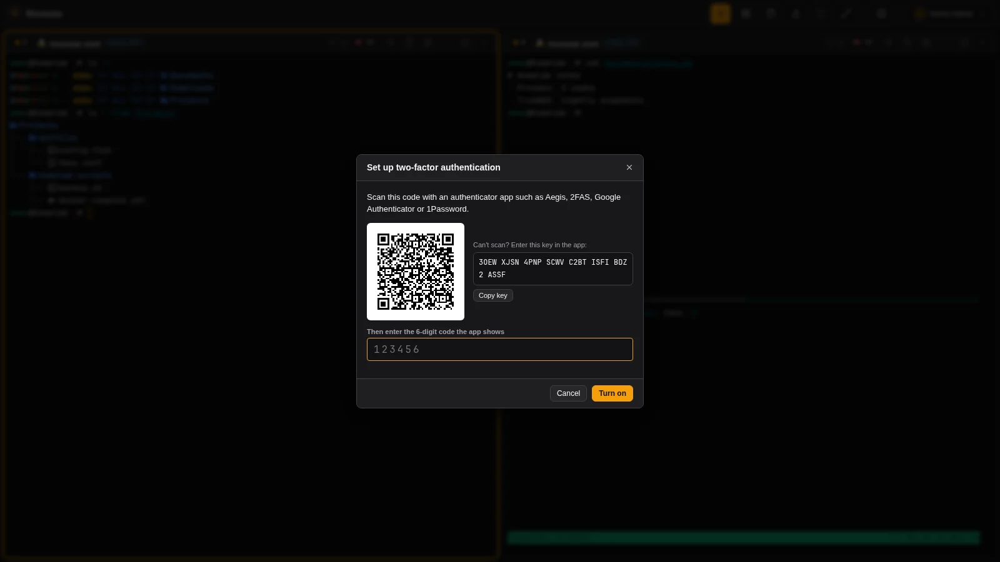
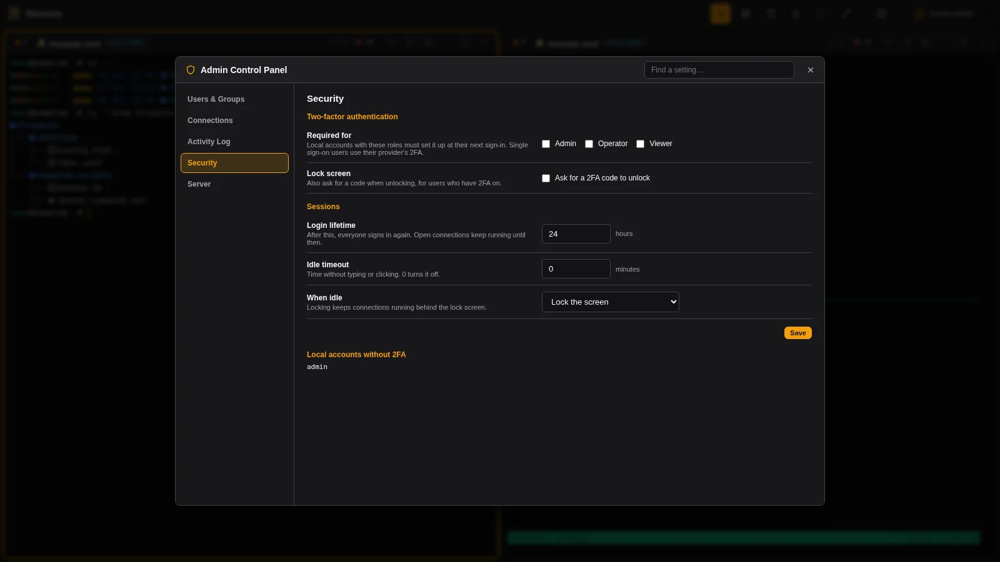

#  Remote

<div align="center">
  
  <p><em>Your remote desktops and terminals in one browser workspace — By Woofson</em></p>
  <p>
    <a href="https://github.com/Woofson/remote/releases/latest"></a>
    <a href="https://crates.io/crates/remoted"></a>
    
    
    <a href="https://ghcr.io/woofson/remote"></a>
    <a href="https://ko-fi.com/J7P327BXTR"></a>
  </p>
</div>

Remote is a web gateway for remote access. You open RDP and VNC desktops, SSH and Telnet terminals, and shells on the server itself in your browser, side by side in one workspace. Nothing needs to be installed on the computer you work from.

It is a single Rust program with the web interface built in and an embedded SQLite database.

| Connections directory | Themes |
| :---: | :---: |
|  |  |
| **Two-factor setup** | **Admin security settings** |
|  |  |

---

## Features

**Connections**
- **RDP** (IronRDP): NLA/CredSSP and TLS, `DOMAIN\user` logins, clipboard, sound playback in the browser, printing to a PDF that opens in the browser (saved in your Files, Prints folder), resolution that follows the pane size, and quality presets (wallpaper, window contents while dragging, animations, themes, font smoothing).
- **VNC** (RFB 3.8): Raw, CopyRect, Hextile, Zlib and ZRLE encodings, VNC password and VeNCrypt TLS/X.509, clipboard.
- **SSH**: password, key or OpenSSH certificate login, plus SFTP file browsing.
- **Telnet**.
- **Local shell** on the Remote server. Each connection can use the server default or any shell installed on the server (fish, bash, zsh and so on).

**Workspace**
- One to four panes (single, side by side, stacked, triple, 2x2), picked from the layout menu or with `Alt+1` to `Alt+4`. Your last layout is remembered.
- Tabs: several sessions in one pane. Opening a connection into a busy pane adds a tab, and sessions in hidden tabs keep running. Drag tabs to reorder them or onto another pane to move the live session there. Your tabs are remembered on your account and come back unconnected; each connects when you open it. Remote desktops in hidden tabs or panes pause their screen updates to save bandwidth.
- Wake-on-LAN: wake a sleeping machine before connecting, or with the Wake button in the connections list.
- Phones and tablets: touchpad or touchscreen mode, pinch to zoom, and a key bar with Esc, Tab, Ctrl, Alt, Win, arrows, F-keys and Ctrl+Alt+Del.
- Session sharing: share a live session through a link, watch only or with control; viewers sign in with their own Remote login.
- Session recording: admins switch it on per connection or per group. Terminal and desktop sessions (RDP, VNC; picture only) are recorded as the browser showed them, never keystrokes, stored encrypted and played back in the browser with seek and speed; terminal recordings are searchable as text, desktop recordings can be saved as a video (.webm). Recordings live in `data/recordings`, which Docker users can mount on a separate disk or NAS. Users see their own recordings and can share them with others when allowed. Kept for a set number of days and within a size limit (`[recording]` in config.toml).
- Floating windows: pop any session out of the grid into a window you can move, resize, minimise and maximise, and dock it back into a pane. Windows are remembered on your account.
- Direct links to saved connections (Copy link in the connection list) for bookmarks and desktop shortcuts.
- Full window mode (`F10` or `Alt+W`), full screen per pane, and a lock screen that keeps your sessions running.
- Terminal based on xterm.js with a bundled JetBrainsMono Nerd Font, so prompts like starship and tools like `eza --icons` display correctly. Full-screen programs such as tmux resize with the pane.
- Keyboard layout for RDP sessions, per connection or per pane (NO, US, GB, SE, DK, FI, DE, FR, ES, IT, or Auto from your browser language). VNC, SSH and terminals follow your own keyboard automatically.
- Clipboard drawer for sending text to and fetching text from a session.
- Themes shared with Brum (Woofsons Amber, Catppuccin, Nord, Dracula, Tokyo Night, Gruvbox, Solarized and more). Add your own `*.toml` theme files to `themes/` or `data/themes/`.

**Files**
- Every user has a private **My files** folder, and there is a **Shared** folder everyone can read and only admins can change, for example for scripts and installers.
- Browse, upload, download and organise both in the browser. RDP sessions with drive redirection see them as `\\tsclient\Files` and `\\tsclient\Shared` (read-only for non-admins).

**Users and access**
- Local accounts with Argon2id password hashing, or single sign-on with any OpenID Connect provider, with automatic accounts and group-to-role mapping.
- **Directory sign-in** with LDAP or Active Directory accounts from the normal login form: accounts are made at the first sign-in, roles and Remote groups follow the directory groups (also groups inside groups), and Remote's two-factor authentication works for them too. Set up and tested under Admin > Directory.
- Roles: Admin, Operator and Viewer. Per connection you control who may connect or edit, the clipboard direction, file transfer and view-only mode.
- Connections are private or global; admins choose a connection's owner and share it with users and groups. Saved connection passwords and keys are encrypted (AES-256-GCM).
- Connections directory with search, filters and sorting; an editor with a **Test connection** button; icons from [selfh.st/icons](https://selfh.st/icons/) (fetched and cached by the server) or your own upload.
- Your settings (theme, layout, pane colours and names) are stored on your account and follow you to other devices.

**Security**
- **Two-factor authentication** with an authenticator app, with one-time recovery codes.
- Admins can require two-factor authentication per role, let users remember a device so it skips the code for a set number of days, set how long a login lasts, and lock or sign out sessions after a period without activity.
- Repeated wrong passwords or codes are slowed down. Sign-ins, failures and security changes are recorded in the activity log, with the visitor's address.
- **Email** (optional): people reset a forgotten password themselves with a single-use link, admins can email new users a link to choose their own password, and users are told when their password or two-factor settings change. Works with any SMTP server; set up under Admin > Email.
- **Admin Control Panel**: users and groups, all connections, the activity log, security settings and a server status checklist.
- **Branding** (Admin > Branding): your own logo, title, welcome text, wallpapers (one picked at random per visit) and accent colour on the login and lock screens, each with a reset to Remote's defaults.

---

## Quick start

```bash
cargo run --release
```

Open `http://localhost:8088` and sign in as `admin`. On first start Remote creates a random password for it, prints it in the console and saves it to `data/initial_admin_credentials.txt` (readable only by you). You choose your own password right after signing in, and the file is then deleted.

Lost the admin password? On the Remote machine run `remoted reset-admin-password` (or `cargo run --release -- reset-admin-password`). It prints a new password and saves it to the same file.

### Docker

```bash
docker run -d --name remote --restart unless-stopped \
  -p 8088:8088 -e PUID=$(id -u) -e PGID=$(id -g) \
  -v ./remote:/remote ghcr.io/woofson/remote:latest
```

Or use the included [`docker-compose.yml`](docker-compose.yml). The `./remote` folder holds everything Remote keeps: `config.toml` (created on first start), `data/` (database, `secret.key`, files, icons) and an optional `themes/` folder. Back up that one folder.

- The first admin password is shown by `docker logs remote` and saved in `remote/data/initial_admin_credentials.txt`. To reset it: `docker exec remote remoted reset-admin-password`.
- Remote runs as the user `PUID`:`PGID` (default 1000:1000), not as root.
- Images are built for **linux/amd64**. On arm64, build your own with `docker build -t remote .`.
- The built-in local shell opens a shell inside the container, not on the Docker host. Delete it or make it private if you do not need it.
- The machines you connect to must be reachable from the container.

---

## Configuration

Settings live in `config.toml` in the working directory. Start from `config.example.toml`; without a `config.toml`, Remote creates one with defaults. `config.toml` is ignored by git.

| Section | Settings |
| :--- | :--- |
| `[server]` | `bind_address` (default `0.0.0.0:8088`), `data_dir`, `token_expiry_hours` (starting value for the login lifetime, later changed under Admin > Security), optional `jwt_secret`, `base_path` and `trusted_proxies` (see below) |
| `[storage]` | `staging_dir`, `max_upload_size_mb`, `auto_cleanup_hours` |
| `[auth]` | `allow_local_login`, `default_role` (default `viewer`), `min_password_length` (default `12`); `[auth.header_login]` for signing in through a reverse proxy |
| `[oidc]` | `enabled`, `issuer_url`, `client_id`, `client_secret`, `redirect_uri`, `scopes`, `auto_provision_users`, `admin_group`, `operator_group` |
| `[clipboard]` | `default_mode` (`bidirectional`, `server_to_client`, `client_to_server`, `disabled`), `max_text_size_bytes` |
| `[logging]` | `level` |

Two-factor requirements, login lifetime and idle timeout are set under **Admin > Security**, the mail server under **Admin > Email**, and directory sign-in under **Admin > Directory**. They are stored in the database.

### Behind a reverse proxy

Remote works behind Nginx, Caddy, Traefik, HAProxy and Cloudflare Tunnel, at its own address or under a sub-path such as `https://example.com/remote/`. Open sessions stay connected through proxy idle limits, the activity log shows visitors' real addresses, and Remote can sign people in from the headers of a sign-in proxy (forward auth). Settings and tested example configurations: [docs/reverse-proxy.md](docs/reverse-proxy.md).

Health checks for monitoring and load balancers: `/api/health` and `/api/ready`.

### Secret key and backups

On first start Remote creates a random secret in `data/secret.key` (readable only by its owner). It signs logins and encrypts saved connection passwords, keys and two-factor secrets. Back it up together with `data/remote.db`: without it, saved credentials cannot be unlocked and two-factor authentication has to be set up again. To use your own secret instead, set a private `jwt_secret` in `config.toml`.

### Passwords and logins

- With email set up, "Forgot password?" on the sign-in page emails a link that works once, for 30 minutes. Two-factor authentication still applies afterwards.
- Admins can reset a user's password (generate one, shown once, set one, or email a link) and require a new password at the next sign-in. New users choose their own password at first sign-in by default.
- If a user loses their phone, an admin can turn off their two-factor authentication from the Users page.
- A password change, reset, disable or role change ends that user's other logins straight away.

Before exposing Remote to a network, review `default_role` and consider requiring two-factor authentication for admins.

---

## Project layout

```
src/
  main.rs            Startup and first-run admin account
  config/            Configuration loader
  db/                SQLite storage: users, groups, connections, settings, audit log
  auth/              Passwords, logins, encryption, two-factor, session rules, OIDC
  server/            HTTP API and WebSocket session tunnels
  transfer/          Files (browser file manager and RDP drive)
  protocols/         rdp.rs, vnc.rs, ssh.rs, telnet.rs, local_pty.rs
frontend/            Web interface (index.html, app.js, app.css), built into the program
```

---

## Status and roadmap

Planned work and known bugs are tracked in [GitHub Issues](https://github.com/Woofson/remote/issues); the overall direction is in [ROADMAP.md](ROADMAP.md).

Release history: [CHANGELOG.md](CHANGELOG.md).

---

## Support & Contributions

I am very humbled for your support. If you find Remote worthy of a ko-fi, I would be very very grateful. Thank you.

[](https://ko-fi.com/J7P327BXTR)

---

## License

MIT, see [LICENSE](LICENSE). Copyright (c) 2026 Bolt J Woofson.
